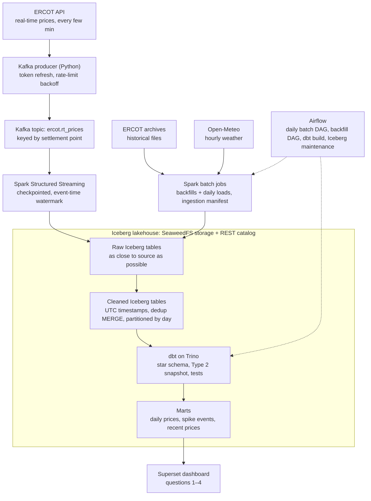

# ERCOT Grid Pipeline

A streaming and batch pipeline that pulls Texas power-grid data from ERCOT's public API, lands it in an Iceberg lakehouse, and answers how electricity prices respond to heat and renewable output. It's built on the open-source core of Netflix's data stack (Kafka, Spark, Iceberg, Trino), runs entirely on your machine in Docker for $0, and fits in weeks 4–8 of `data-engineering-roadmap.md`.

## Why this dataset

ERCOT runs the Texas power grid and publishes its market and operations data through a free public API. It works well for a portfolio pipeline for four reasons:

- **It updates constantly.** New real-time prices arrive every few minutes, so there's a genuine live stream to push through Kafka, and scheduled incremental loads do real work instead of reprocessing a static file.
- **It's big enough for Spark.** Years of 15-minute prices across hundreds of settlement points run into the hundreds of millions of rows.
- **It's messy in instructive ways:** daylight-saving gaps and repeats, expiring auth tokens, a rate limit, late and corrected data, and two ingestion paths (a live API and bulk historical archives). Each one is an interview story.
- **It's a local hiring market.** Texas energy traders, retail electricity providers, and ERCOT itself all hire data engineers, and the project shows you can work with their data.

**The questions it answers.** Keeping the pipeline aimed at a few questions stops it from turning into a platform with no purpose:

1. How do real-time prices respond to temperature, and how much does a heat wave move them?
2. How has the share of wind and solar in the generation mix changed by season and hour of day?
3. When did price spikes happen, and what were load, temperature, and renewable output at the time?
4. Is a price spike happening right now, and how does it compare to the same hour over the past 30 days? (This is the question the streaming path exists to answer.)

**One existing tool to know about:** the open-source [gridstatus](https://opensource.gridstatus.io) library already wraps ERCOT's API. Use it as a reference, but write your own ingestion, because that's the skill the project demonstrates.

## Architecture

Everything runs in Docker Compose on your machine.

Two ingestion paths feed one lakehouse. Live prices stream through Kafka into Spark Structured Streaming; history, weather, and daily loads come in through Spark batch jobs. Both write the same raw table layout. Spark does the heavy lifting (stream processing, backfills, and the MERGE into the cleaned layer), and dbt does the modeling by running SQL through Trino. Every table is an Iceberg table stored in SeaweedFS, so Spark and Trino see the same data through the shared catalog. This same diagram goes in the README.

**How it maps to Netflix's stack,** which is worth saying in interviews:

| Netflix | This project | Note |
| --- | --- | --- |
| Kafka | Kafka | Same |
| Spark | Spark | Same; batch and Structured Streaming |
| Iceberg | Iceberg | Same; Netflix created it |
| Trino/Presto | Trino | Same |
| S3 | SeaweedFS | S3-compatible, so the design moves to AWS unchanged |
| Flink | Spark Structured Streaming | Flink is a stretch goal |
| Maestro | Airflow | Maestro is open source but heavy to stand up |
| (none) | dbt | Not central at Netflix; added because most data engineering jobs use it |

## Data model

A star schema built in dbt from the cleaned Spark tables. Every table is an Iceberg table. State the grain of every table in the README; interviewers check for it.

| Table | Kind | Grain (one row per…) | Main columns |
| --- | --- | --- | --- |
| `fct_rt_price` | Fact | settlement point per 15-minute interval | interval_start_utc, settlement_point_key, price_usd_per_mwh |
| `fct_load` | Fact | weather zone per hour | hour_start_utc, weather_zone_key, load_mw |
| `fct_renewables` | Fact | source (wind or solar) per region per hour | hour_start_utc, source, region, output_mw |
| `fct_weather` | Fact | weather zone per hour | hour_start_utc, weather_zone_key, temp_f |
| `dim_settlement_point` | Dimension, SCD Type 2 | settlement point per version | name, type (hub, load zone, node), load_zone, valid_from, valid_to, is_current |
| `dim_weather_zone` | Dimension | weather zone | name, representative city, lat/lon |
| `dim_date` | Dimension | calendar day (Central time) | date, day of week, season, holiday flag |
| `mart_daily_prices` | Mart | load zone per day | avg, min, max price, spike intervals |
| `mart_price_spikes` | Mart | spike event | start, end, peak price, load, temp, renewable share |
| `mart_recent_prices` | Mart | hub or load zone per interval, last 48 hours | price, 30-day same-hour average, spike flag |

**Why `dim_settlement_point` is Type 2:** ERCOT publishes a mapping of settlement points to load zones that changes as nodes are added and retired. Joining a 2019 price to today's mapping would misattribute it, so each price joins to the version that was valid at that time. That's the SCD question in almost every modeling interview, answered with real data.

Store all timestamps in UTC and convert to Central time only in `dim_date` and the marts. The "hard parts" section below explains why.

## The hard parts

These problems come built into the data and the stack, and solving them is what separates this from a tutorial project. Write each one up in the README as a short decision record. Each maps directly to a common interview deep-dive.

| Problem | What you build | Interview topic it prepares |
| --- | --- | --- |
| Daylight saving: one fall day repeats an hour and one spring day skips one. ERCOT's files flag the repeated interval. | Convert to UTC using the flag; add tests that pin both transition days every year | Time zones, correctness, data quality |
| Two ways in: a live stream and bulk historical archives (up to 1,000 files per request) | A streaming job and a parameterized backfill DAG, both writing the same raw layout | Backfills, reprocessing, batch vs. streaming |
| A 30-requests-per-minute rate limit, and tokens that expire hourly and can't be refreshed | A producer that caches the token, re-authenticates on expiry, and backs off on HTTP 429 | Resilient ingestion, retries |
| Kafka is at-least-once, and reruns and overlapping archive pulls create duplicates too | Message keys and Spark checkpoints for the stream, an ingestion manifest (file, checksum, load time) for batch, and an Iceberg `MERGE INTO` on the natural key in the cleaned layer | Idempotency, exactly-once vs. at-least-once |
| Live intervals can arrive late or out of order, and ERCOT occasionally republishes corrected prices | Event-time processing with a watermark; corrections land through the same MERGE | Event time vs. processing time, late data |
| A stream that commits every minute creates thousands of tiny files | A scheduled Iceberg compaction (`rewrite_data_files`) and snapshot expiry; measure query time before and after | File layout, table maintenance |
| Settlement point mappings change over time | A dbt snapshot that builds the Type 2 dimension | Slowly changing dimensions |
| Prices are 15-minute, while load and weather are hourly | Roll prices up to the hour for joins, and document which marts use which grain | Grain and granularity mismatch |
| Prices can legitimately go negative or spike far above normal | dbt tests that check uniqueness, nulls, and freshness without rejecting real extremes | Data contracts, observability |
| Hundreds of millions of rows once you add every node | Partition by day with Iceberg's hidden partitioning and sort by settlement point; measure before and after. Later, change the partition spec with partition evolution, without rewriting history | Partitioning, performance |
| A bad load or bad dbt run corrupts a table | Query and roll back to an earlier Iceberg snapshot | Recovery, time travel |

The partitioning and compaction rows are where your SQL Server performance work carries over. Benchmark before and after the same way you did with the `MERGE` procs, and put the numbers in the README.

## Build plan

**Build a thin slice first, then widen it.** Get one day of data flowing from the API to a dashboard query before adding volume, sources, streaming, or orchestration. A working thin pipeline in week 4 beats a perfect ingestion layer with nothing downstream.

**The MVP:** hub and load-zone prices, backfilled in batch and streaming live through Kafka, plus weather, landing in a tested star schema with one dashboard that answers question 1. Everything past that is extra.

**Week 4: the thin slice**

- [x] Bring up the core stack in Docker Compose (SeaweedFS, Iceberg REST catalog, Spark, Trino). On day 1, write an Iceberg table from Spark and read it from Trino (see setup)
- [x] Pull one day of hub and load-zone prices from the API and write them to a raw Iceberg table with a Spark batch job
- [ ] Build one dbt model on top through Trino and query it

**Week 5: history and correctness**

- [ ] Backfill 2+ years from the bulk archives, including every settlement point
- [ ] Add the ingestion manifest and make every load idempotent with `MERGE INTO`
- [ ] Handle daylight saving and pin it with tests
- [ ] Partition and sort the cleaned tables; record query times before and after

**Week 6: the stream**

- [ ] Add Kafka to the stack and write the producer: poll real-time prices, handle token expiry and 429s, key messages by settlement point
- [ ] Spark Structured Streaming job from Kafka into the raw table, with checkpointing and a watermark
- [ ] Kill and restart the streaming job mid-run; confirm there are no gaps or duplicates
- [ ] Add batch ingestion for load, wind and solar output, and weather

**Week 7: model, orchestration, and serving**

- [ ] Build the star schema in dbt, including the Type 2 snapshot
- [ ] Add dbt tests for keys, nulls, freshness, and the DST days
- [ ] Airflow DAGs: daily batch load, parameterized backfill, dbt build and test, nightly Iceberg compaction
- [ ] Build the marts and a Superset dashboard answering questions 1–4
- [ ] Make a failed run alert you, and make reruns safe

**Week 8: write it up, then stop**

- [ ] README: architecture diagram, data model with grains, decision records for the hard parts, benchmark numbers, what you'd change at 10x
- [ ] Optional: a 3-minute recorded walkthrough showing the stream live, and a GitHub Actions check that runs unit tests and compiles dbt
- [ ] Add the project to your resume bank (`add-accomplishment`)

**Out of scope until you've landed a job:**

- Price forecasting or any ML
- A custom web front end
- Cloud deployment (see the stretch goals)
- Terraform, Kubernetes, or multi-cloud setups

**Stretch goals, only after week 8. Pick one:**

- **Flink:** rewrite the streaming job in Flink, which is what Netflix uses for stream processing, and compare it with the Spark version.
- **Write-audit-publish:** stage each batch load on an Iceberg branch, run checks against it, and publish only if they pass. This is Netflix's data quality pattern.
- **One-weekend AWS deploy:** swap SeaweedFS for S3, the REST catalog for Glue, and local Spark for EMR Serverless, then tear it all down. Set a billing alert first.

## Stack and setup

Everything runs on your machine in Docker Compose. There are no cloud costs.

| Layer | Choice | Notes |
| --- | --- | --- |
| Live ingestion | Python producer (`confluent-kafka`) | Polls the ERCOT API and publishes to Kafka |
| Streaming | Apache Kafka | Single broker in KRaft mode, so no ZooKeeper; one container |
| Processing | Apache Spark (PySpark), batch and Structured Streaming | Local mode (`local[*]`); optionally a Standalone cluster across two machines |
| Object storage | SeaweedFS (S3 gateway) | S3-compatible, so the same paths and APIs work on AWS; replaced MinIO (decision 001) |
| Table format | Apache Iceberg | MERGE, time travel, schema and partition evolution |
| Catalog | Iceberg REST catalog | Lets Spark and Trino see the same tables; Apache Polaris or Nessie are drop-in alternatives |
| Query engine | Trino | Interactive SQL, and the engine dbt runs on |
| Transformations | dbt Core with the `dbt-trino` adapter | Incremental models with `merge`, snapshots, tests |
| Orchestration | Apache Airflow in Docker | Airflow appears in more job postings than Dagster; Dagster is a fine swap if you prefer it |
| Dashboard | Apache Superset | Connects to Trino |
| Weather | Open-Meteo historical API | No key needed for non-commercial use; hourly data back to 1940 |

**Setup notes that shape the design:**

- **Memory.** The full stack wants about 16GB of RAM. If that's tight, run only what the current week needs: Kafka can stay off until week 6, and Airflow and Superset until week 7.
- **The day-1 integration check.** Spark and Trino must both point at the same REST catalog and reach SeaweedFS. Spark needs the Iceberg Spark runtime and AWS bundle jars, plus an S3 endpoint set to SeaweedFS with path-style access. Getting a table written by Spark and read by Trino is the riskiest wiring in the project, so do it first. Start from the Iceberg project's Spark quickstart Docker Compose file, which already includes Spark and a REST catalog; swap its MinIO service for SeaweedFS with the S3 gateway enabled (MinIO stopped shipping open-source images in 2025, see `docs/decisions/001-object-storage-seaweedfs.md`), and add Trino and Kafka to it.
- **Spark reads Kafka** through the `spark-sql-kafka` connector package, which must match your Spark version.
- **Your laptop isn't always on.** That's fine. Airflow's catchup re-runs missed batch intervals when you start it again, and the streaming job resumes from its last Kafka offset as long as the topic's retention covers the gap (set it to a few days). Both are good demonstrations of the recovery design.

**Accounts to set up:**

- [ ] ERCOT API Explorer account and subscription key. Tokens last an hour and can't be refreshed, and access is blocked from outside the US.
- [ ] A public GitHub repo

## Sources

- [ERCOT Public API: registration and authentication](https://developer.ercot.com/applications/pubapi/user-guide/registration-and-authentication)
- [ERCOT Public API: known limits](https://developer.ercot.com/applications/pubapi/known-limits/)
- [Apache Iceberg: Spark quickstart](https://iceberg.apache.org/spark-quickstart/)
- [Apache Iceberg documentation](https://iceberg.apache.org/docs/latest/)
- [dbt: Trino setup](https://docs.getdbt.com/docs/core/connect-data-platform/trino-setup)
- [Apache Kafka quickstart](https://kafka.apache.org/quickstart)
- [Open-Meteo historical weather API](https://open-meteo.com/en/docs/historical-weather-api)
- [gridstatus open-source library](https://opensource.gridstatus.io)
